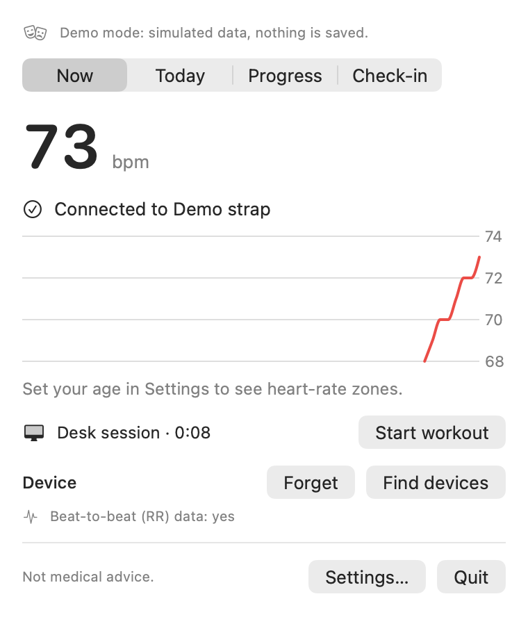
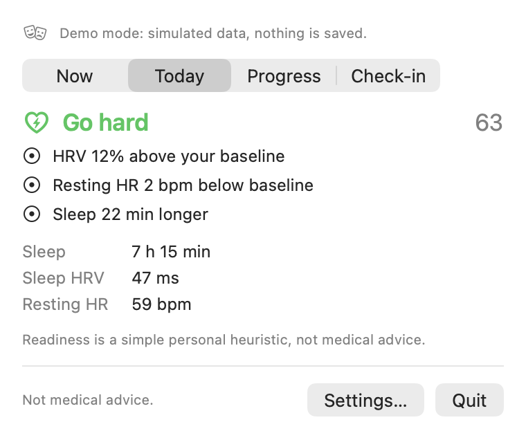
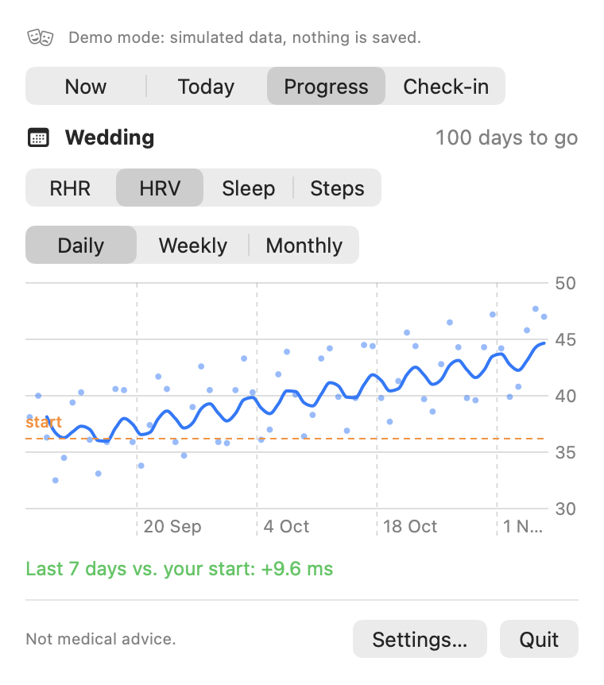

# PulseBar

A free, open-source **macOS menu-bar app** that helps people who sit at a desk all day improve
their cardiovascular fitness and recovery (**HRV up, resting heart rate down**) toward a personal
goal date, using their own wearable data. Everything stays on your Mac.

<p>
  
  
  
</p>

> **Health disclaimer.** PulseBar is not a medical device and does not give medical advice.
> It doesn't diagnose anything and can't detect heart conditions. Readiness and habit patterns are
> simple personal heuristics. Consult a doctor before making major changes to your training.

## What it does

- **Live heart rate in the menu bar** from any device that broadcasts the standard Bluetooth
  Heart Rate Service: Fitbit Air (with *Share heart rate* on), chest straps, many watches.
  Shows a 10-minute chart, your heart-rate zone and the Zone 2 band.
- **Desk sessions and gentle nudges.** Sessions are saved automatically; if your heart rate stays well
  above your resting level for a while during work hours, you get one calm suggestion to take a break.
- **Morning readiness** (*Go hard / Normal day / Take it easy*) against *your own* 30-day baseline of sleep
  HRV, resting heart rate and sleep, always with the reasons in numbers.
- **Progress toward your goal date**, with weekly/monthly charts against your starting baseline.
- **A 10-second evening check-in** and, once there's enough data, which habits line up with better or worse
  next-morning recovery (associations, never claims of cause).
- **Ask Claude about your data** through a local, read-only connector: *"Give me my weekly review."*
- **Private by design.** No accounts, no servers, no analytics.

Requires **macOS 26 or later**.

## Install

1. Download `PulseBar-x.y.z.zip` from the [latest release](https://github.com/harshil-jangid/pulsebar/releases/latest).
   Optionally compare its SHA-256 with the `.sha256` file:
   ```bash
   shasum -a 256 ~/Downloads/PulseBar-*.zip
   ```
2. Double-click the zip and drag **PulseBar.app** into **Applications**.
3. Open PulseBar. Because it's free and not notarized by Apple (that needs a paid developer account),
   macOS blocks it the first time. Then:
   - open **System Settings → Privacy & Security**, scroll to **Security**,
   - click **Open Anyway** next to the PulseBar message, and confirm with your login password.

   The button appears for about an hour after you tried to open the app
   ([Apple's guide](https://support.apple.com/guide/mac-help/open-a-mac-app-from-an-unknown-developer-mh40616/mac)).
4. Look for the **♡** in your menu bar. A welcome window walks you through the rest.

**Prefer maximum trust?** Build it yourself from source (below); it's the same code you can read here.

**Known limitations of free (ad-hoc) signing**
- After installing an update, macOS may ask again for Bluetooth or Keychain access.
- If the Claude connector is blocked (Settings → Claude → *Test connector* says macOS blocked it), clear
  the download flag for PulseBar only, once:
  ```bash
  xattr -dr com.apple.quarantine /Applications/PulseBar.app
  ```

**Can't see the ♡?** On MacBooks with a notch, a crowded menu bar hides icons. Turn off a few icons in
System Settings → Menu Bar, or use a menu-bar manager. Opening PulseBar again (Spotlight) also brings the icon back.

## Connect your heart-rate device

1. On a Fitbit Air: Google Health app → **Connections** → your device → **Share heart rate**
   ([Google's steps](https://support.google.com/fitbit/answer/14236705)). Other straps broadcast automatically.
2. Click ♡ → **Find devices** → **Connect**. PulseBar remembers it and reconnects on its own.

PulseBar only *listens* to the standard heart-rate signal. It never sends commands to your device,
changes its settings or touches its pairing.

## Connect Google Health (optional)

Readiness and progress use your history from the official Google Health API. You create your own free
Google client (about 5 minutes); see **[docs/google-setup.md](docs/google-setup.md)** or Settings → Google.

## Connect Claude (optional)

Turn on Settings → Claude, copy the snippet into Claude desktop's config, restart Claude, then ask:

- "Give me my weekly review."
- "Plan this week's training from my recovery."
- "Why was my HRV low on Tuesday?"
- "How am I progressing toward my goal?"
- "Which of my habits line up with better sleep HRV?"

Details: **[docs/claude-connector.md](docs/claude-connector.md)**.

## Privacy

- Data lives only in `~/Library/Application Support/PulseBar/` (readable by your user only).
  Turn on FileVault so the disk itself is encrypted.
- Google sign-in tokens are stored in your macOS Keychain.
- Network: Google's sign-in and Health API (only if you connect Google) and an optional daily GitHub
  release check. Nothing else, ever.
- Export everything (CSV + JSON) or delete everything from Settings → Data.

More: **[docs/privacy.md](docs/privacy.md)**.

## Build from source

Requirements: macOS 26+, Xcode 26+ (free from the Mac App Store), [Homebrew](https://brew.sh).

```bash
brew install xcodegen
```

```bash
git clone https://github.com/harshil-jangid/pulsebar.git && cd pulsebar && xcodegen generate && open PulseBar.xcodeproj
```

Then press ⌘R. Useful extras:

| Command | What it does |
|---|---|
| `xcodebuild test -project PulseBar.xcodeproj -scheme PulseBar -destination 'platform=macOS'` | All tests |
| `./scripts/test-core.sh` | Core-library tests only (works with just the Command Line Tools) |
| Run with argument `-demo` | Simulated heart rate and sample history in a throwaway database |
| `./scripts/build-release.sh` | Signed, zipped release build in `build/release/` |

Architecture: **[docs/architecture.md](docs/architecture.md)**. Product spec: **[SPEC.md](SPEC.md)**.

## License

[MIT](LICENSE). Uses [GRDB.swift](https://github.com/groue/GRDB.swift) (MIT).
